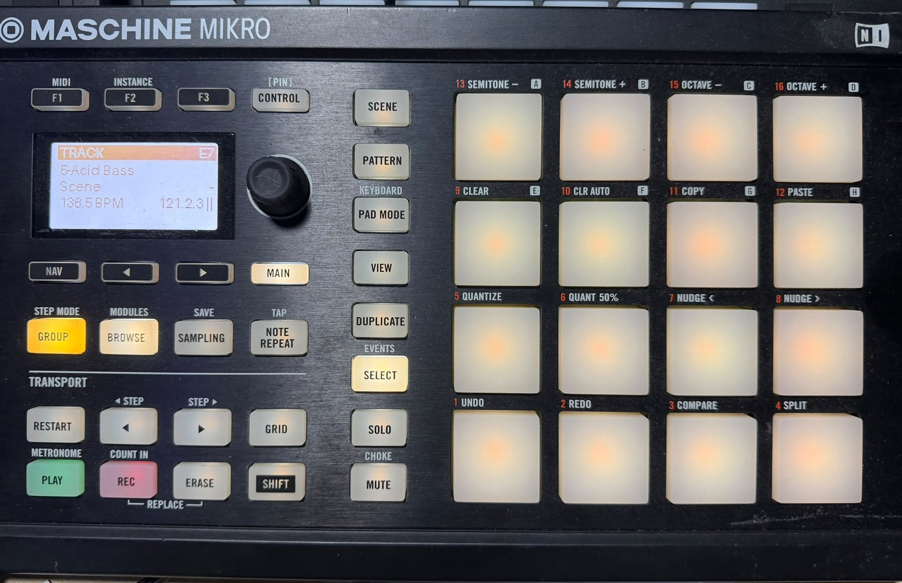
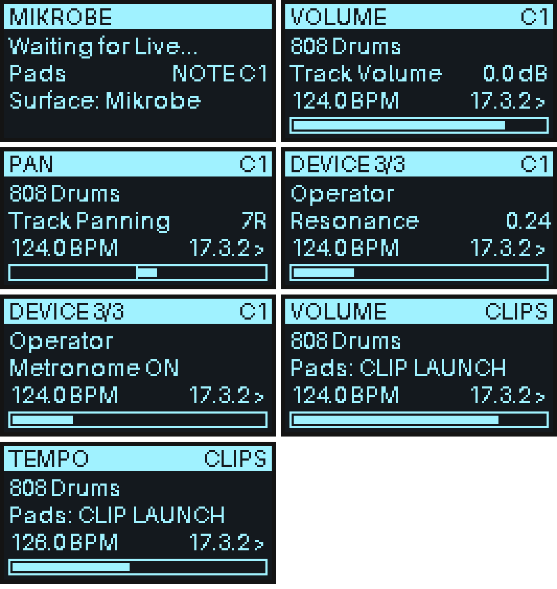

# Mikrobe

**Maschine Mikro MK2 for Ableton Live — no NI software required.**

[](https://github.com/DIGITUI/mikrobe/actions/workflows/ci.yml)
[](LICENSE)

Mikrobe lets you use a **Native Instruments Maschine Mikro MK2** as an Ableton Live controller **without the Maschine software, Controller Editor or NI drivers**. Pads, buttons, encoder, RGB pads, button LEDs **and the 128×64 screen** all work.

<p align="center"></p>
<p align="center"><sub>Mikrobe running on a Mikro MK2 with Ableton Live: TRACK mode, with the selected track, tempo and song position on the screen.</sub></p>

## Features

- **Velocity-sensitive pads.** Pad 1 starts at C1, which matches a Drum Rack. Optional poly or channel aftertouch.
- **Clip launching.** A 4×4 grid with clip colours that follows the selected track and scene. Live shows a coloured box around the grid. Queued clips flash; recording clips pulse.
- **Screen.** Shows the encoder mode, track or device name, the parameter name and value with a value bar, tempo, song position and play/record state, plus short popup messages.
- **Encoder modes.** Volume, pan, sends, device parameters, tempo and track scrolling. Hold SHIFT for fine adjustment.
- **Transport and editing.** Play, record, loop, undo/redo, metronome, tap tempo, capture MIDI, and scene and clip duplication.
- **Button LEDs** follow Live's state. The GROUP button shows the selected track's colour.
- **One-step macOS installer.** The bridge runs in the background and starts at login.
- **Platforms:** macOS (Apple Silicon and Intel) and Windows. Live 10.1.13, 11 and 12.

> **Status: beta (v0.1.0).** The USB protocol comes from proven open-source drivers. The whole pipeline is covered by a simulation test, and it runs on real hardware (photo above); testing across different machines and Live versions is still limited. Bug reports and button-mapping reports are very welcome; see [Contributing](CONTRIBUTING.md).

## How it works

The Mikro MK2 doesn't send MIDI. It's a USB HID device, and normally NI's background service translates it into MIDI. This project replaces that service.

```
Mikro MK2 ──USB HID──► bridge/mikrobe.py ──"Mikrobe Controls" (MIDI)──► Ableton Live
          ◄─LEDs + screen─                    ◄─"Mikrobe Feedback" (SysEx)─  Mikrobe control surface
```

| Part | What it does |
|---|---|
| `bridge/` | A Python program that reads pads, buttons and the encoder over HID, creates the two MIDI ports, and draws the screen and LEDs. |
| `ableton/Mikrobe/` | An Ableton control surface script that maps the controls to Live and sends back the screen text, LED states and pad colours. |

The wire protocol is documented in [docs/PROTOCOL.md](docs/PROTOCOL.md).

---

## Installation

### macOS (recommended: installer)

1. Download or clone this repo.
2. **Right-click `scripts/macos/install_mac.command` → Open → Open.** macOS blocks a plain double-click on downloaded scripts. You can also run `bash scripts/macos/install_mac.command` in Terminal.
3. Answer **Y** when it asks to disable **NIHardwareAgent**. NI's agent locks the controller so nothing else can use it.
4. Set up Live (see [below](#set-up-ableton-live)).

The installer sets up the bridge in `~/Library/Application Support/Mikrobe`, in its own Python environment. It copies the control surface into `~/Music/Ableton/User Library/Remote Scripts/` and adds a LaunchAgent that runs the bridge at login and restarts it if it stops. The log is at `~/Library/Logs/Mikrobe.log`.

- `scripts/macos/bridge_control_mac.command` lets you restart or stop the bridge, view the log, and run the hardware tests.
- `scripts/macos/uninstall_mac.command` removes the bridge and re-enables NI's agent.

You need Python 3.8 or newer. If it's missing, the installer tells you how to get it.

### Windows

1. Install Python 3.8+ from python.org. Tick *Add to PATH* during setup.
2. Install **loopMIDI** (tobias-erichsen.de) and create two ports named exactly `Mikrobe Controls` and `Mikrobe Feedback`. Windows can't create virtual MIDI ports by itself, so loopMIDI provides them.
3. In a terminal: `pip install -r bridge/requirements.txt`
4. Copy `ableton/Mikrobe` to `Documents\Ableton\User Library\Remote Scripts\Mikrobe`.
5. Run `bridge/start_bridge_windows.bat`. It ends `NIHardwareAgent.exe` first. To keep NI's agent from coming back, set the *NIHardwareService* / *NIHostIntegrationAgent* services to Manual.

### Linux / manual

```bash
pip3 install -r bridge/requirements.txt
sudo cp bridge/99-maschine-mikro-mk2.rules /etc/udev/rules.d/   # Linux: then re-plug the device
python3 bridge/mikrobe.py
```

### Set up Ableton Live

Restart Live, then open **Settings → Link, Tempo & MIDI**:

| Control Surface | Input | Output |
|---|---|---|
| **Mikrobe** | Mikrobe Controls | Mikrobe Feedback |

In **MIDI Ports**:
- Turn on **Track** and **Remote** for the `Mikrobe Controls` input. Track lets the pads play instruments.
- Turn on **Remote** for the `Mikrobe Feedback` output.

The screen changes from *"Waiting for Live..."* to the Live view. You can start the bridge and Live in either order, and you can unplug and replug the Mikro while they're running.

### Check your hardware

```bash
python3 bridge/mikrobe.py --list            # is the Mikro visible? (17cc:1200)
python3 bridge/mikrobe.py --monitor         # prints every pad/button/encoder event
python3 bridge/mikrobe.py --test display    # screen test pattern
python3 bridge/mikrobe.py --test leds       # lights every LED in turn
```

Stop the background bridge first; on macOS the control script does this for you. If a button name printed by `--monitor` doesn't match the label on your device, please [open a mapping report](../../issues/new?template=button_mapping.md).

---

## Controls

### Screen


```
┌──────────────────────────────┐
│ VOLUME                    C1 │  encoder mode · pad mode (NOTE base note / CLIPS)
│ 808 Drums                    │  selected track (or device in DEVICE mode)
│ Track Volume          0.0 dB │  parameter and value (or a short popup message)
│ 124.0 BPM           17.3.2 > │  tempo · song position · play/rec state
│ [██████████████████       ]  │  value bar (centred for pan)
└──────────────────────────────┘
```

### Encoder modes
| Button | Encoder controls | Encoder push |
|---|---|---|
| F1 | Selected track volume | Reset |
| F2 | Pan | Reset to centre |
| F3 | Send (press again for the next send) | Reset |
| CONTROL | Device parameter. ◀ ▶ picks the parameter; SHIFT + ◀ ▶ picks the device | Reset |
| NAV | Tempo (SHIFT = 0.1 BPM steps) | Tap tempo |
| MAIN | Scroll through tracks | Launch selected clip |

### Pads
**PAD MODE** switches between two modes:
- **NOTES:** the pads play the selected or armed track. SHIFT + transport ◀ ▶ shifts the pads by 16 notes; SHIFT + PAD MODE resets them to C1.
- **CLIPS:** a 4×4 launch grid with the top row as the first scene. SHIFT + pad selects a slot without launching it.

### Buttons
| Button | Action | With SHIFT |
|---|---|---|
| PLAY | Start / stop | Continue |
| RESTART | Play from the start | Loop on/off |
| REC | Session record | Arrangement record |
| ERASE | Undo | Redo |
| GRID | Metronome | |
| NOTE REPEAT | Tap tempo | |
| SAMPLING | Capture MIDI | Automation arm |
| Transport ◀ ▶ | Previous / next scene | Jump 4 scenes (CLIPS) or shift pads by 16 notes (NOTES) |
| ◀ ▶ (by the screen) | Previous / next track | Jump 4 tracks |
| GROUP | Launch the selected clip | Stop the track's clips |
| BROWSE | Show / hide the browser | |
| SCENE | Launch the selected scene | Insert a new scene |
| PATTERN | Stop all clips | |
| VIEW | Switch between Session and Arrangement | |
| DUPLICATE | Duplicate the selected clip | Duplicate the scene |
| SELECT | Arm the track | |
| SOLO / MUTE | Solo / mute the selected track | |

---

## Configuration

Edit `bridge/config.json`. The macOS installer copies it to `~/Library/Application Support/Mikrobe/config.json`. Restart the bridge after making changes.

| Key | Default | Meaning |
|---|---|---|
| `pad_on_threshold` / `pad_off_threshold` | 400 / 250 | Pressure (0–4095) needed to trigger and to release a note. Raise these if pads fire by themselves. |
| `pad_full_scale` | 3000 | Pressure that gives velocity 127. |
| `velocity_curve` | 0.7 | Below 1 makes soft hits louder; above 1 makes them quieter. |
| `velocity_attack_ms` | 3 | How long to wait after a hit to read its peak pressure. 0 means lowest latency. |
| `fixed_velocity` | 0 | Set to 1–127 to give every hit the same velocity. |
| `aftertouch` | `"off"` | `"poly"` or `"channel"`. |
| `encoder_invert` | false | Flips the encoder direction. |
| `led_on` / `led_dim` | 127 / 10 | Button LED brightness. |
| `display_invert` | false | Swaps black and white on the screen. |
| `font_size` | 11 | Screen font size. |

## Troubleshooting

- **"Maschine Mikro MK2 not found":** run `--list`. Make sure NIHardwareAgent, Maschine and Controller Editor aren't running. On macOS, if you get access errors, give your Terminal app *Input Monitoring* permission.
- **Mikrobe isn't in Live's control surface list:** the folder must be named exactly `Mikrobe` and be inside `User Library/Remote Scripts/`. Check Live's `Log.txt` for lines starting with `Mikrobe`.
- **Pads play but buttons do nothing:** turn on **Remote** for the input port.
- **Screen stuck on "Waiting for Live":** the control surface Output isn't set to `Mikrobe Feedback`.
- **A button does the wrong thing:** run `--monitor` and see [CONTRIBUTING.md](CONTRIBUTING.md#button-mapping).

## Development

```bash
pip install pillow mido
python tests/test_e2e.py
```
The test simulates the controller's USB messages and Ableton's API, then runs the real bridge and the real script against each other. It checks the MIDI routing, LED and pad colours, and the screen byte format, and it saves PNG snapshots of the screen. It needs no hardware and no copy of Live. CI runs it on every push.

## Credits

The HID protocol (button bits, LED order, pad report, display page format) comes from the reverse-engineering work of **[timsavage/maschine-rs](https://github.com/timsavage/maschine-rs)** (MIT) and **Ardour's Maschine2 control surface** by Robin Gareus. No code from Native Instruments is used.

## Disclaimer

This is an independent project. It is not affiliated with or endorsed by Native Instruments or Ableton. *Maschine* is a trademark of Native Instruments GmbH; *Ableton Live* is a trademark of Ableton AG. Disabling NIHardwareAgent affects other NI hardware until you re-enable it.

## License

[MIT](LICENSE)
